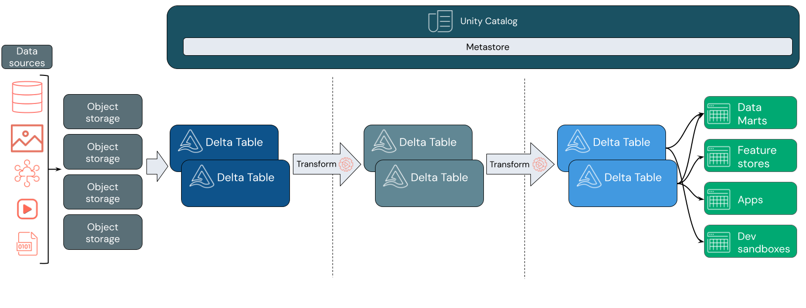
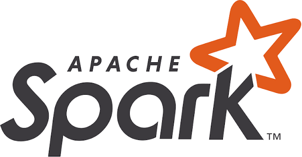

# Engenharia de Dados com Databricks e PySpark

## Boas-vindas

<br>

**Minicurso WANDA — UEPB**

Graduação em Estatística e Ciência de Dados  

<br>

**Repositório do projeto:** [https://github.com/pedroallmeiida/minicurso_databricks_wanda](https://github.com/pedroallmeiida/minicurso_databricks_wanda)


## O que vamos discutir

<br>

- Engenharia de dados e computação em nuvem
- Dados para Big Data: tipos, formatos e armazenamento
- Bancos de dados tradicionais, Data Warehouse e Data Lake
- Armazenamento por linha, por coluna e sistemas de arquivos
- Delta Lake e a arquitetura Lakehouse
- Apache Spark, PySpark e sua relação com Databricks


# Engenharia de dados e cloud

## O que é Engenharia de Dados?

<br>

É a área que projeta e mantém os sistemas que tornam os dados **disponíveis, confiáveis e utilizáveis**.

- **Integra** dados de diferentes fontes
- **Organiza** armazenamento e processamento
- **Automatiza** fluxos de dados
- **Cuida** de qualidade, segurança, disponibilidade e custos
- **Prepara** dados para análises, produtos de dados e modelos estatísticos/ML

<br>

> A Engenharia de Dados cria as condições para que análises e decisões sejam reproduzíveis e confiáveis.

## Engenharia de dados no ciclo de vida

<br>

O trabalho acompanha o dado desde sua origem até o uso:

<br>

1. **Origem:** aplicações, transações, sensores, arquivos e APIs
2. **Ingestão:** entrada em lote ou contínua
3. **Armazenamento:** bancos, sistemas de arquivos e armazenamento em nuvem
4. **Processamento:** validação, integração e transformação
5. **Disponibilização:** tabelas, análises de dados e aplicações de modelos ML
6. **Operação:** monitoramento, governança, segurança e controle de custos


## O que muda quando usamos cloud?

<br>

Na nuvem, organizações contratam recursos computacionais e serviços pela rede, sob demanda.


- **Elasticidade:** aumentar ou reduzir recursos conforme a necessidade
- **Serviços gerenciados:** o provedor administra parte da infraestrutura
- **Armazenamento durável:** capacidade escalável sem depender de um único servidor local
- **Pagamento por uso:** custos variam com armazenamento, processamento e tráfego
- **Acesso distribuído:** equipes e aplicações podem consumir dados em diferentes locais


Cloud não elimina a arquitetura ou a operação: muda quem administra cada parte e como os recursos são consumidos.

## IaaS, PaaS e SaaS

<br>

| Modelo | O que o provedor entrega | Exemplo de responsabilidade do cliente |
|---|---|---|
| **IaaS** — infraestrutura | Máquinas virtuais, rede e discos | Instalar e administrar sistema operacional e aplicações |
| **PaaS** — plataforma | Ambiente gerenciado para desenvolver e executar aplicações | Construir soluções e administrar dados e permissões |
| **SaaS** — software | Aplicação pronta acessada pela internet | Configurar o uso e administrar usuários/conteúdo |

## Databricks

<br>


<br>


:::: {.columns}

::: {.column width="40%"}

<br>

{width=100%}
:::

::: {.column width="60%"}

- O **Databricks** é uma plataforma unificada e aberta de análise para criar, implementar, compartilhar e manter **soluções de dados, análises e IA** de nível empresarial em **grande escala**. 

<br>

- A **Plataforma de Dados e IA do Databricks** integra-se com o armazenamento e a segurança em nuvem da sua conta na nuvem e **gerencia** e **implementa** a **infraestrutura de nuvem** para você.

:::

::::


---

### Responsabilidades e decisões na nuvem

<br>

Mesmo usando serviços gerenciados, o engenheiro de dados continua responsável por:

<br>

- **Onde** os dados serão armazenados e em qual região
- **Quem** pode acessar cada conjunto de dados
- **Como os dados são protegidos**, retidos e recuperados
- **Como o consumo e os custos** são controlados
- **Como a monitoração** de falhas, atrasos e qualidade é realizada


# Dados, bancos e armazenamento

## Dados para Big Data

<br>

*Big Data* descreve cenários em que escala, velocidade ou diversidade tornam insuficientes abordagens tradicionais isoladas.

<br>

- **Volume:** quantidade de dados
- **Velocidade:** frequência de geração e necessidade de processamento
- **Variedade:** diferentes formatos e estruturas
- **Veracidade:** confiabilidade, origem e qualidade
- **Valor:** utilidade obtida a partir dos dados


## Formas de dados e formatos

<br>

| Forma | Características | Exemplos de formatos |
|---|---|---|
| **Estruturados** | Campos e tipos definidos, organizados em tabelas | tabelas relacionais, CSV |
| **Semiestruturados** | Estrutura marcada, mas flexível ou variável | JSON e XML |
| **Não estruturados** | Não seguem naturalmente um esquema tabular fixo | texto, imagens, áudio, vídeo |

O formato influencia leitura, compressão, evolução do esquema e custo de processamento.

## Arquivos para Big Data

<br>


| Formato | Organização | Uso comum |
|---|---|---|
| **CSV** | Texto delimitado, legível, sem tipos ricos embutidos | Troca simples de dados e pequenas extrações |
| **JSON** | Texto semiestruturado, flexível e aninhável | APIs, eventos e documentos |
| **Parquet** | Binário colunar, tipado e comprimido | Análises e armazenamento em data lakes |
| **ORC** | Binário colunar com compressão e estatísticas | Consultas analíticas em ecossistemas Hadoop |


## BD: o modelo relacional

<br>

Bancos relacionais organizam dados em tabelas com colunas, tipos e relações.

- O **esquema** define a estrutura esperada
- As **Chaves** representam identidade e relacionamentos
- **SQL** permite consultar e modificar dados
- As **Restrições** ajudam a preservar integridade

São fundamentais para aplicações transacionais, cadastros, pagamentos e muitos outros sistemas. Não estão **obsoletos**: continuam sendo uma ferramenta adequada para inúmeros problemas.

---

### Limitações dos bancos tradicionais em cenários analíticos

<br>

As dificuldades aparecem quando se tenta usar um banco transacional como única solução para grandes cargas analíticas:

- Consultas analíticas extensas competem com operações transacionais
- Crescimento vertical pode ficar caro ou atingir limites operacionais
- Variedade de dados e esquemas em rápida mudança exige adaptações
- Guardar grandes volumes de arquivos brutos em bancos pode ser caro


<!---
## Online Transaction Processing (OLTP)

<br>

Registra as operações do dia a dia, mantendo o estado atual do negócio.

<br>

**Exemplo: compra em um e-commerce**

- Registrar o pedido
- Confirmar o pagamento
- Atualizar o estoque
- Consultar o status da entrega

São operações curtas, alta repetição e ligadas a registros específicos.


## Online Analytical Processing (OLAP)

<br>

Consulta dados históricos para resumir resultados e apoiar decisões.

<br>

**Exemplos de perguntas**

- Qual foi a receita por região e mês?
- Quais categorias cresceram mais neste ano?
- Qual é o prazo médio de entrega por estado?
- Como a avaliação dos clientes varia por categoria?

As consultas costumam ler muitos registros, filtrar colunas e calcular agregações.
--->

## Armazenamento por linha

<br>

Em um banco de dados orientado a linhas, os atributos de cada registro são armazenados conjuntamente, de forma que uma linha completa possa ser recuperada com eficiência.
<br>

| pedido_id | cliente | cidade | 
|---:|---|:---:|:---:|
| 101 | Ana | Campina Grande | 
| 102 | Rui | João Pessoa |
| 103 | Lia | Campina Grande | 

<br>

```text
Registro 1:[pedido_id=101 | cliente=Ana | cidade=Campina Grande]
Registro 2:[pedido_id=102 | cliente=Rui | cidade=João Pessoa]
```


---

### Vantagens e desvantagens do armazenamento por linha


<br>


✅ Recupera-se a linha completa facilmente

✅ Adequado a transações pequenas e frequentes

✅ Ótimo para bancos relacionais como PostgreSQL, MySQL, SQL Server e Oracle

❌ Pode exigir leitura de muitos dados quando uma consulta analítica usa poucas colunas de muitas linhas

❌ A compressão tende a ser menos eficiente que em dados colunares homogêneos


## Armazenamento por coluna

<br>

Em um sistema orientado a colunas, valores da mesma coluna ficam agrupados.

<br>

| pedido_id | cliente | cidade | 
|---:|---|:---:|:---:|
| 101 | Ana | Campina Grande | 
| 102 | Rui | João Pessoa |
| 103 | Lia | Campina Grande | 

<br>

Registro por coluna: 

```text
id:      [101, 102, 103]
cliente: [Ana, Rui, Lia]
cidade:  [Campina Grande, João Pessoa, Campina Grande]
```


---

### Vantagens e desvantagens do armazenamento por coluna

<br>

✅ Em uma consulta, apenas as colunas selecionadas precisam ser lidas

✅ Bom para agregações e consultas que leem poucas colunas de muitas linhas

✅ Valores semelhantes favorecem compressão e leitura seletiva

✅ Adequado a data warehouses e análises em grande escala

<br>

❌ Atualizar um registro isolado é menos eficiente: como os valores de uma mesma linha ficam espalhados por colunas diferentes, é preciso localizar e reescrever blocos em cada coluna afetada

❌ Em cargas com muitas alterações (updates e deletes frequentes), essa reescrita constante dos arquivos eleva o custo de processamento


---

### Armazenar por linha ou coluna? 

Imagine uma tabela de pedidos com estas colunas:

::: {.filesystem-table style="font-size: 0.8em"}
| pedido_id | cliente | estado | valor |
|---:|---|:---:|---:|
| 101 | Ana | PB | R$ 120 |
| 102 | Rui | PE | R$ 80 |
| 103 | Lia | PB | R$ 60 |
:::

<br>

:::: {.columns}

::: {.column width="50%"}
**Por linha: Quais são os dados do pedido 102?**


- O banco localiza o registro de cada atributos e os lê em conjunto.

- É comum em bancos transacionais como PostgreSQL e MySQL.
:::

::: {.column width="50%"}
**Por coluna : Quanto foi vendido em cada estado?**

- Para responder, basta ler as colunas `estado` e `valor`; 

- É eficiente para agregar muitas linhas lendo poucas colunas.
:::

::::

---

## Sistemas de arquivos

<br>

- Um **sistema de arquivos** é uma forma de organizar, armazenar e nomear dados em um dispositivo de armazenamento, como disco rígido, SSD, cartão de memória, ou qualquer outro meio de armazenamento persistente. 

<br>

- Ele **controla** como os arquivos são colocados no **dispositivo de armazenamento**, como são lidos e gravados, e como os diretórios e caminhos são estruturados.

---

## Exemplos de sistemas de arquivos

<br>

- **NTFS** (*New Technology File System*) — padrão do Windows, usado em discos internos de desktops e notebooks

- **ext4** (*Fourth Extended File System*) — comum em distribuições Linux, presente em servidores e máquinas pessoais

- **APFS** (*Apple File System*) — padrão da Apple (macOS e iOS), otimizado para SSDs

- **FAT32** (*File Allocation Table, 32 bits*) e **exFAT** (*Extended FAT*) — usados em pendrives e cartões de memória, pela compatibilidade entre sistemas operacionais

<br>

- A escolha do sistema de arquivos afeta o tamanho máximo de arquivo, as permissões de acesso, o desempenho e a compatibilidade entre dispositivos.

---

## O que é um cluster?

<br>

- Um **cluster** é um conjunto de computadores (chamados de **nós**) conectados em rede que trabalham juntos como se fossem um único sistema.

- Cada nó contribui com seus próprios recursos: processador, memória e disco.

- As tarefas são divididas entre os nós, permitindo **processar em paralelo** volumes de dados que uma única máquina não daria conta.

- Se um nó falha, os demais assumem o trabalho — o sistema continua funcionando (**tolerância a falhas**).

- É sobre clusters que rodam ferramentas como Hadoop, Spark e o próprio Databricks.

---

### Sistemas de arquivos distribuídos

<br>

- Sistema de arquivos que permite que o acesso a arquivos e dados seja transparente, independentemente de onde os dados estejam fisicamente armazenados, geralmente em vários nós de um cluster.

- Projetado para armazenar e analisar grandes volumes de dados de maneira distribuída e paralela em um cluster de computadores. 

- Divide os arquivos em blocos, distribuindo em todo cluster para permitir armazenamento e processamento paralelo.

- Exemplos incluem HDFS (Hadoop Distributed File System) e sistemas de arquivos distribuídos em nuvem, como Amazon S3 e Azure Data Lake Storage.

---

## DBFS (Databricks File System)

<br>

- É o sistema de arquivos distribuído do Databricks, integrado à plataforma.
- Permite armazenar dados de forma persistente e acessá-los de qualquer cluster Databricks.
- Suporta operações típicas de sistemas de arquivos, como leitura, gravação e listagem de arquivos.
- Pode ser usado para armazenar dados brutos, resultados intermediários e notebooks em python/R.

- Para tarefas de processamento de dados, o Databricks utiliza o Apache Spark.


# Data Warehouse, Data Lake e Delta Lake

## Data Warehouse

<br>

Repositório analítico organizado para consultas, relatórios e indicadores.

- Dados frequentemente integrados, estruturados e preparados para análise
- Esquema e regras de negócio mais explícitos
- Otimizado para consultas analíticas e uso de SQL
- Pode oferecer controle de acesso, qualidade e desempenho gerenciados
- Tradicionalmente associado a custos e processos de preparação maiores; soluções atuais variam bastante

**Exemplos de serviços:** Snowflake, BigQuery, Amazon Redshift e Microsoft Fabric Warehouse.

## Data Lake

<br>

Armazenamento escalável para dados em estado bruto ou transformado, em diferentes formatos.

- Costuma usar armazenamento de objetos na nuvem
- Aceita dados estruturados, semiestruturados e arquivos multimídia
- Permite separar custo de armazenamento e capacidade de processamento
- Esquema pode ser aplicado durante a leitura ou pelas camadas de processamento

::: {.callout-warning}
Um diretório cheio de arquivos não se torna, sozinho, um Data Lake confiável. Catálogo, segurança, qualidade, metadados e gestão do ciclo de vida são partes da arquitetura.
:::

---

### Data Warehouse versus Data Lake

<br>

{width=100% fig-align="center" style="text-align: center"}


## Delta Lake

<br>

Delta Lake é um **formato de tabela aberto** que acrescenta metadados e transações a arquivos de dados, comumente Parquet, em armazenamento de objetos.

- **Transaction log:** registra alterações e permite reconstruir o estado da tabela
- **Schema enforcement/evolution:** valida ou permite mudanças controladas no esquema
- **Time travel:** permite consultar versões retidas da tabela
- **MERGE, UPDATE e DELETE:** operações de mudança em nível de tabela


## Lakehouse

**Lakehouse** é uma abordagem que combina flexibilidade e armazenamento de baixo custo de um data lake com capacidades de gestão e análise associadas a warehouses.

- Mantém dados em armazenamento escalável, frequentemente *object storage*
- Usa formatos de tabela como Delta Lake
- Pode servir dados para SQL, BI, ciência de dados e machine learning
- Exige governança, catálogo, controles de acesso e boas práticas operacionais

##  Arquitetura Lakehouse


<br>

{width=100%}


## Conceito Medallion Databricks

<br>

O conceito Medallion no Databricks organiza os dados em camadas, facilitando a ingestão, limpeza, integração e análise.

- **Bronze:** dados brutos, ingestão inicial
- **Silver:** dados limpos e integrados
- **Gold:** dados agregados e prontos para análise


# Apache Spark


{width=100% fig-align="center" style="text-align: center"}


Apache Foundation: https://www.apache.org/projects/


## O que é Apache Spark?

<br>

Apache Spark é um **motor open source de processamento distribuído**.

- Distribui o processamento de conjuntos de dados entre recursos computacionais
- Oferece APIs para Python, Scala, Java, R e SQL
- Suporta processamento em lote e streaming, além de bibliotecas para análise
- Pode trabalhar com diferentes fontes e formatos
- É um projeto da Apache Software Foundation, com ampla comunidade

Spark não é um banco de dados nem um serviço de armazenamento: é principalmente um **motor de computação**.


## Integração com spark

<br>

{width=100% fig-align="center" style="text-align: center"}


# PySpark

{width=100% fig-align="center" style="text-align: center"}


## O que é PySpark?

<br>

**PySpark** é a API Python do Apache Spark.

- Permite expressar operações distribuídas com DataFrames e SQL
- Combina o ecossistema Python com o processamento do Spark
- O código Python coordena operações; os dados podem ser processados em executores do cluster
- Não significa que qualquer código Python será distribuído automaticamente


# Databricks

{width=85%}

https://www.databricks.com/


## O que é Databricks?

<br>

Databricks é uma plataforma de dados e IA em nuvem fundada pelos criadores do Apache Spark.

- Oferece ambientes gerenciados para engenharia de dados, SQL, analytics e ML
- Integra processamento Spark, formatos de tabela e armazenamento em cloud
- Inclui notebooks, compute, workflows, ferramentas SQL e governança
- Integra-se aos principais provedores de nuvem
- Busca oferecer uma experiência Lakehouse

::: {.callout-note}
Databricks **não é o Apache Spark**: Spark é um projeto open source; Databricks é uma plataforma que utiliza Spark e adiciona serviços, ferramentas, integrações e componentes próprios.
:::

---

### Como Spark e Databricks se relacionam?

<br>

| Apache Spark | Databricks |
|---|---|
| Motor de processamento open source | Plataforma gerenciada de dados e IA |
| Executa aplicações em infraestrutura configurada | Provisiona e administra ambientes de compute |
| Inclui APIs e engine de execução | Disponibiliza notebooks, jobs, ferramentas SQL e integrações |
| Pode ser instalado ou usado em diferentes serviços | Usa Spark, com otimizações e componentes específicos da plataforma |

**Analogia:** Spark é o motor de processamento; Databricks oferece o veículo, os controles e os serviços ao redor do motor.

## O que a plataforma Databricks oferece?

<br>

- **Workspace e notebooks:** desenvolvimento colaborativo
- **Compute:** clusters e recursos para executar workloads
- **Delta Lake:** tabelas com transações e metadados
- **SQL e BI:** consultas e serviços analíticos
- **Workflows:** agendamento e orquestração de tarefas
- **Unity Catalog:** catálogo, governança, permissões e linhagem, conforme a edição e configuração

Os nomes e funcionalidades exatos evoluem; verifique a documentação e disponibilidade do ambiente utilizado.


## Vamos para parte prática !!!


<br>

Na etapa de prática, vamos conduzir a construção de um pipeline com dados de comércio eletrônico da Olist:

- Ingestão e tabelas **Bronze**
- Limpeza e integração na camada **Silver**
- Agregações analíticas na camada **Gold**
- Transformações com PySpark e armazenamento Delta

**Repositório do projeto:** [https://github.com/pedroallmeiida/minicurso_databricks_wanda](https://github.com/pedroallmeiida/minicurso_databricks_wanda)


**Baixar os dados:** [https://www.kaggle.com/datasets/olistbr/brazilian-ecommerce](https://www.kaggle.com/datasets/olistbr/brazilian-ecommerce)


